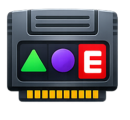

<p align="center">
  
</p>

<h1 align="center">Cartridge</h1>

<p align="center">Your Steam, GOG and Epic games on one shelf, stored on your Mac.</p>

Cartridge is a desktop app for people whose game library is spread across several stores. It imports what you own on Steam, GOG and Epic Games into one browsable library with cover art, playtime and scores. You can add your own status, ratings, tags, notes and lists on top.

Everything lives in a single file on your machine. There is no Cartridge account, no cloud sync and no subscription.

> **Status: early (0.1.0).** macOS is the primary target. There are no prebuilt releases yet: you build it from source (see [Getting started](#getting-started)).

## What it does

- **Imports your libraries**
  - **Steam:** owned games, playtime and last played.
  - **GOG:** owned games and store metadata.
  - **Epic:** owned games and store metadata; Epic doesn't expose playtime.
  - A game you own on more than one store becomes one entry with several copies.
- **Downloads cover art** and keeps it locally.
- **Lets you add your own layer:** status (backlog, playing, beaten, dropped, wishlist), a 1–5 star rating, free-form tags (with suggestions from tags you already use), notes, links and custom fields.
- **Organises games in lists**, either manual or smart (saved filters). Add games to a manual list from the game's page or by right-clicking them in the library. Lists can be deleted from the list header or by right-clicking them in the sidebar.
- **Shows scores:** Steam user reviews (% positive) and the Metascore, also for games you own only on GOG or Epic (see [Scores](#scores)).
- **Has grid and list views**, with search, sorting and filters by genre, store, status, release year and minimum score.
- **Launches games** by handing off to the Steam, GOG Galaxy or Epic launcher, which needs to be installed. Settings can ask you to confirm each launch, and sync all accounts when the app opens.

## Getting started

### Requirements

- macOS with the Xcode Command Line Tools (`xcode-select --install`)
- [Rust](https://rustup.rs/) 1.82 or newer
- [Node.js](https://nodejs.org/) 18 or newer and [pnpm](https://pnpm.io/)

See Tauri's [prerequisites](https://v2.tauri.app/start/prerequisites/) if anything is missing.

### Run and build

```bash
pnpm install
pnpm tauri dev      # run the app with hot reload
pnpm tauri build    # build the .app and .dmg into src-tauri/target/release/bundle/
```

## Connecting your stores

Open **Settings** and choose **Add an account**.

| Store | What you need |
|---|---|
| Steam | A Steam Web API key from [steamcommunity.com/dev/apikey](https://steamcommunity.com/dev/apikey), and your 17-digit SteamID64 (from [steamid.io](https://steamid.io/) or your profile URL). In your Steam privacy settings, **Game details** must be set to Public, otherwise Steam returns no games. |
| GOG | Click **Connect** and sign in on GOG's own login page. Cartridge never sees your password. |
| Epic Games | Click **Connect** and sign in on Epic's own login page. Playtime isn't available from Epic. |

Sync each account from Settings, or all of them at once with the sync button in the toolbar.

## Scores

Cartridge fills in two scores, both from Steam's public store data. No API key is needed for either.

- **Steam reviews:** the share of positive user reviews, the same figure the Steam store shows. Games with fewer than 10 reviews show no percentage.
- **Metacritic:** the Metascore that Steam lists for the game.

**Games owned on GOG or Epic** are looked up on Steam by title. The match has to be exact, or the same game in a different edition ("Game of the Year", "Definitive", "Remastered"…). Sequels and other games in the same series are deliberately skipped: no score is better than the wrong one. The game page shows which Steam game the scores come from. If it's wrong, choose **Not this game**. If a game wasn't found, paste its Steam store link.

**Games no longer sold on Steam** don't appear in Steam's search. Their reviews are still available, so pasting the Steam link works for them too.

**Refreshing** happens in the background, when the app starts and after every sync. Steam allows only about one Metacritic lookup every 1.6 seconds, so the first pass over a large library takes a while: around 25 minutes for 1,000 games. Scores appear as they arrive, and an interrupted pass resumes next time. Each game is rechecked every 30 days.

## Your data

| What | Where |
|---|---|
| Library (games, lists, your data, settings) | `~/Library/Application Support/com.cartridge.app/library.json` |
| Cover art | `~/Library/Application Support/com.cartridge.app/covers/` |

- **Backups:** to back up your library, copy `library.json`; **Reveal in Finder** in Settings → Local data shows it. It's written atomically, so a crash can't leave it half-written. If Cartridge can't read the file when it starts, it moves it aside as `library.corrupt-<time>.json` in the same folder and starts with an empty library, instead of overwriting it.
- **Export:** **Export JSON** in Settings → Local data saves a copy of your library wherever you choose. Credentials are not included.
- **Credentials:** your Steam API key and your GOG and Epic sign-in tokens are stored in the same file. They are not encrypted, so anyone who can read your user files can read them. They are never passed to the app's interface.
- **Network:** Cartridge connects only to Steam, GOG and Epic, to import libraries, covers and scores. Fonts and everything else in the interface ship with the app.

## Not done yet

- **Score refresh progress:** there's no progress indicator for the background score refresh; it's only visible in the `pnpm tauri dev` console as `[Scores]` lines.
- **Platforms:** Windows and Linux builds are untested.

## Development

The app is built with Tauri 2, a Rust backend in `src-tauri/`, and SvelteKit 2 with Svelte 5 as a static frontend in `src/`.

```bash
pnpm check                       # type-check the frontend
cd src-tauri && cargo test       # backend unit tests
cargo test -- --ignored live_    # a few tests against the real Steam API
cargo clippy                     # lint
```

[CLAUDE.md](CLAUDE.md) describes the architecture, the directory layout, how the frontend talks to Rust, and the design conventions. [PLAN.md](PLAN.md) records how the app was built, section by section.

## License

MIT — see [LICENSE](LICENSE).

The bundled Geist and Geist Mono fonts (`static/fonts/`) are © Vercel and licensed under the [SIL Open Font License 1.1](static/fonts/OFL.txt).
